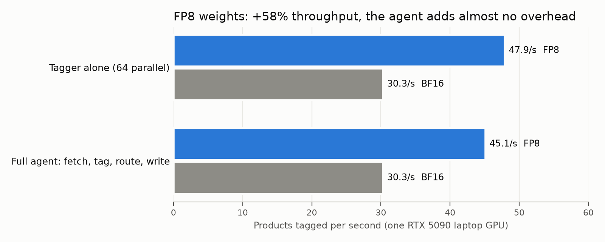
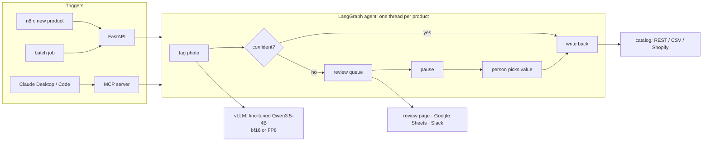
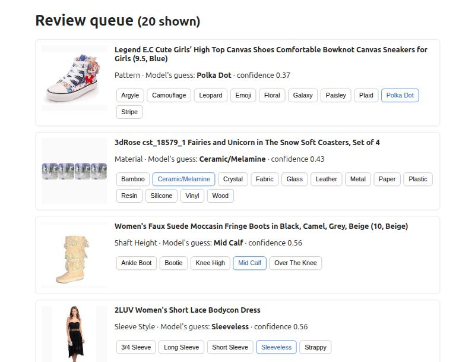

# catalog-automation-agent

[](https://m8ven.ai/mcp/captof-omuamua-catalog-automation-agent-1n6rnj?s=readme)

**An AI agent that fills in and checks product attributes from photos: fetch → tag →
auto-approve or ask a reviewer → write back.** It runs on one laptop GPU with a fine-tuned 4B
vision model, survives crashes and flaky APIs without losing or duplicating work, and plugs
into Shopify, n8n, Slack, Google Sheets, any REST/CSV catalog, and Claude (over MCP).

Measured on [ImplicitAVE](https://github.com/HenryPengZou/ImplicitAVE) (hand-checked test
set, 1,610 products; every threshold chosen on a separate dev set):

- **79.2% of products tagged automatically at 94.6% accuracy;** the other 20.8% go to a
  reviewer. Catalog accuracy after review: 95.7%.
- **Catalog QC: catches 67.8% of wrong listing attributes at 90% precision,** with false alarms
  on 1.8% of correct listings.
- **Crash-safe:** with 10% of API calls failing, 5% of replies lost and the agent killed
  mid-run, the re-run lost **0** products and wrote **0** twice.
- **45 products per second with FP8 weights** on an RTX 5090 laptop GPU (30 with bf16), about
  **₹0.35 per 1,000 products** (6 GPU-hours per million).



## How it works



1. **Tag.** The fine-tuned vision model from
   [visual-product-tagging](https://github.com/captof-omuamua/visual-product-tagging) answers
   from the attribute's allowed values only (JSON schema), with a confidence score.
2. **Route.** Confidence ≥ 0.72 (chosen on validation for a 95% accuracy target) is written
   back; anything lower pauses for a person. In **QC mode**, a listing whose stated value the
   model confidently contradicts (≥ 0.86, chosen on dev) is flagged instead.
3. **Pause and resume.** A waiting product is a paused LangGraph thread. Approving it in the
   review page, the API, Google Sheets or from Claude resumes that thread, which writes the
   answer.
4. **Write safely.** Every write carries an idempotency key (product + attribute + source +
   model version), so a retried or replayed write is applied once. Only temporary errors
   (timeouts, 5xx, 429) are retried; a product that fails is tried again on the next run.



## Results

Full tables: [reports/results.md](reports/results.md). Dev was used for every choice; each
test number below comes from a single run.

### Filling in attributes (test, 1,610 products)

| Weights | Model accuracy | Auto-tagged | Accuracy of auto-tagged | Sent to review | Write fidelity | After review |
|---|---|---|---|---|---|---|
| **bf16** | 85.7% | **79.2%** | **94.6%** | 20.8% | 100% | 95.7% |
| FP8 | 84.9% | 79.6% | 94.4% | 20.4% | 100% | 95.5% |

Reference points on the same test set: GPT-4V 86.8% (ImplicitAVE paper, Table 4); the tagger
alone 85.3% and 79% auto-accepted at 94.6%
([visual-product-tagging](https://github.com/captof-omuamua/visual-product-tagging)). The
agent adds the workflow without losing accuracy. "After review" assumes the reviewer picks
the right value.

### Catalog QC

Listings state a value for the attribute, and a seeded 20% state a wrong one (another allowed
value). On test, the agent flagged 231 listings: 208 of the 307 wrong ones (**67.8%**) at
**90.0%** precision, plus false alarms on 1.8% of correct listings. Random corruptions are
easier to spot than real seller mistakes, so treat this as an upper-end estimate; there is no
published baseline for this task.

### Reliability

1,000 products. The catalog API fails 10% of calls (503) and applies 5% of writes but loses
the reply (500). The agent was killed with SIGKILL after 15 s, then the batch was re-run:

| Products | Written | Waiting for review | Lost | Written twice | Duplicates stopped by the key | Retries per 100 |
|---|---|---|---|---|---|---|
| 1,000 | 761 | 239 | **0** | **0** | 52 | 15.3 |

### Throughput and cost

| Weights | Tagger alone (64 parallel) | Full agent | GPU-hours per 1M products | ₹ per 1,000 |
|---|---|---|---|---|
| bf16 | 30.3 /s | 30.3 /s | 9.2 | 0.53 |
| **FP8** | 47.9 /s | **45.1 /s** | 6.2 | **0.35** |

FP8 weights (`QUANT=fp8`) are quantised by vLLM at load time with CUTLASS FP8 kernels: +58%
throughput for about 1 point of accuracy. Cost = GPU time × $0.60 per GPU-hour (a rented 24-32
GB GPU) at ₹95.46/$, the same assumption as the tagger project.

## What the measurements changed

- **A parity check caught a silent 46-point drop.** Forcing whitespace-free JSON (a vLLM
  flag that fixed another model in my previous project) dropped dev accuracy from 86.6% to
  39.5% with no errors, because the model was fine-tuned on `{"value": "X"}` with a space.
  Running the new client against the tagger project's saved answers first caught it.
- **Profiling found the slow part.** With FP8 the agent first ran at 34.7/s while the tagger
  alone did 48/s. Every product's state was checkpointed after every step through one SQLite
  connection. Saving only when a product finishes or pauses (safe because writes are
  idempotent) brought it to 45/s.

Details: [docs/dev_log.md](docs/dev_log.md). Design and alternatives:
[docs/adr/0001-catalog-agent-plan.md](docs/adr/0001-catalog-agent-plan.md).

## Quickstart

Needs an NVIDIA GPU (the model weights are ~9 GB; tested on 24 GB), Docker, [uv](https://docs.astral.sh/uv/),
and the fine-tuned model from
[visual-product-tagging](https://github.com/captof-omuamua/visual-product-tagging) (or any
vision-language model vLLM serves, via `MODEL=`).

```bash
make setup          # .venv (CPU-only; vLLM runs from its own environment)
make up             # mock catalog API + n8n in Docker
make serve-tagger   # the tagger on vLLM at :8000 (QUANT=fp8 for FP8); log: logs/vllm.log
make api            # http://127.0.0.1:8080/docs and the review page at /review/ui
python scripts/run_agent.py --products data/products_dev.jsonl --limit 50   # a batch
```

The evaluation data comes from ImplicitAVE (not redistributed): `python scripts/build_data.py`
builds the dev, test, load and QC files from the dataset folder (`AGENT_IAVE_ROOT`). Then:
`scripts/parity_check.py`, `eval_tagging.py --split dev|test`, `eval_qc.py --split dev|test`,
`eval_reliability.py`, `eval_throughput.py --label bf16|fp8`, and `report.py`.

### Use it from Claude (MCP)

Four tools: `tag_product`, `list_review_queue`, `approve_tags`, `run_catalog` (dry run by
default).

```bash
claude mcp add catalog-agent -- /path/to/catalog-automation-agent/.venv/bin/catalog-agent-mcp
```

### n8n

`n8n/new_product_workflow.json`: webhook (new product) → agent API → if it needs review, a
Slack message. Load it with `make n8n-import`. Without `SLACK_WEBHOOK_URL`, messages go to
the API's local Slack stand-in (`logs/notifications.jsonl`). n8n runs on the host network
bound to 127.0.0.1, so nothing is exposed beyond the machine.

### Connectors

| Connector | For | Notes |
|---|---|---|
| `RestConnector` | a store's own catalog API (big catalogs) | list / image / write routes; the mock store implements them |
| `FileConnector` | JSONL exports, batch jobs | writes go to a JSONL file, one per idempotency key |
| `ShopifyConnector` | Shopify stores | Admin GraphQL; products tagged `needs-attributes` in, metafields out. Tested against recorded API responses, not a live store |

## Limitations

- QC is measured on synthetic (random) corruptions; real seller errors are subtler.
- The Shopify connector is tested on recorded responses only; the Slack and Google Sheets
  adapters are tested with stand-ins.
- Dev labels are machine-made (only test is hand-checked), so dev QC precision may be slightly
  understated.
- Throughput is for one laptop GPU and 512-px images; one attribute per product (ImplicitAVE).
- The review page has no login. Keep the API on localhost, or put it behind auth.

---

Author: Sisir Kausthubh. Code licence: MIT. ImplicitAVE (Zou et al., ACL Findings 2024) is not
included in this repo. Models: Qwen3.5-4B (Apache-2.0), fine-tuned in visual-product-tagging.
n8n is fair-code (Sustainable Use License); only a workflow file is included.
