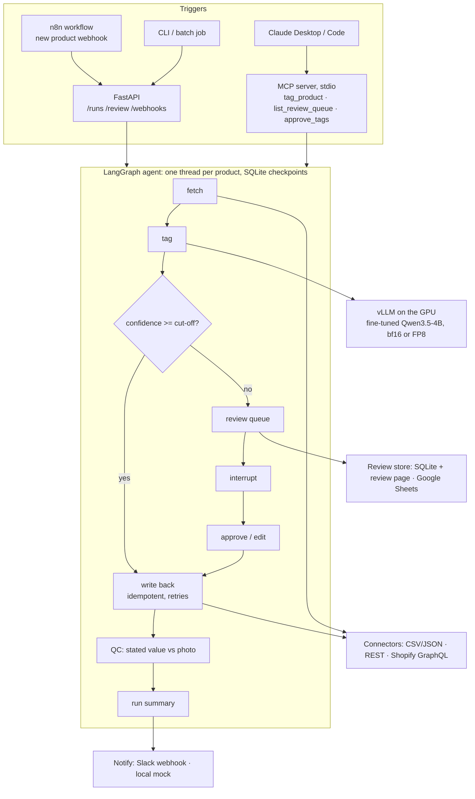

# ADR-0001: Plan for catalog-automation-agent

**Status:** Accepted (built 2026-10-30; outcome at the end)
**Date:** 2026-10-30
**Deciders:** Sisir Kausthubh
**Target:** done by Monday 2026-11-02

## Context

Project 2 of the freelance portfolio (handoff doc: "Business-automation agent with an MCP
server"). It proves the gig types no current repo shows: AI agents, n8n automation, MCP
servers, e-commerce AI. It must also speak to big catalog teams (fashion, furniture, quick
commerce) and to NVIDIA (GPU inference throughput).

What we already have:

- **The tagger** (visual-product-tagging): fine-tuned Qwen3.5-4B, merged bf16 weights at
  `~/catalog-vlm-cascade/outputs/iave-qwen35-4b-merged` (8.7 GB, local only). On the 1,610
  hand-checked ImplicitAVE test questions: 85.3% (GPT-4V 86.8%). Answers are constrained to
  the allowed values by a JSON schema; confidence = probability of the chosen value's tokens.
  Cut-off 0.72 (chosen on validation) auto-accepts 79% at 94.6%. Measured 23.7 products/s
  (32 parallel requests, 512 px images), costed at $0.60 per GPU-hour → ₹0.67 per 1,000.
- **Project 1 parts** (docs-rag-assistant): repo layout, Makefile, CI with a light install,
  vLLM serve script, LLM call logging, eval and report scripts.
- **Hardware:** one RTX 5090 laptop GPU (24 GB), no Jetson, no nvcc, Docker without the
  NVIDIA runtime. Good news: the agent itself needs no GPU (no embedder), so only vLLM uses it.

Data facts (checked): in ImplicitAVE each product has exactly one attribute question, so
product-level and question-level numbers are the same.

| Split | Products | Labels | Use |
|---|---|---|---|
| dev | 2,000 (validation sample, seed 0: same as the tagger project) | machine-made | choose every threshold |
| test | 1,610 | hand-checked | report, run once per metric |
| load | 5,000 from the 54,876 training products | not used | throughput only |

## Options considered

| Option | Scope | Time | Pitch | Risk |
|---|---|---|---|---|
| A. Lean agent | LangGraph agent, CSV + REST connectors, SQLite review queue, FastAPI, tagging eval, throughput | ~0.5 day | Big stores: fair. Freelance: weak (no n8n, no MCP) | Low |
| **B. Full agent (recommended)** | A + MCP server + n8n workflow (Docker, local) + Shopify connector (fixture-tested; live if you create a dev store) + Slack/Sheets adapters with local mocks + catalog QC mode + fault-injection reliability test + bf16 vs FP8 throughput | ~1.5 days | Both audiences, plus a GPU-throughput result for NVIDIA | Medium: FP8 on this GPU may not load (then bf16 only) |
| C. B + NVIDIA serving stack | + TensorRT-LLM / Triton engine, self-hosted Langfuse, GPT-vision fallback run | 3+ days | Strongest NVIDIA signal | High: TensorRT-LLM needs build tooling and a GPU container runtime we lack; misses Monday |

**Decision: B.** It covers every gig type in the handoff doc, adds the two things big catalog
teams ask about (QC of existing listings, measured throughput and cost), and gives an honest
GPU result (FP8 on Blackwell) without betting the deadline on TensorRT-LLM.

Not built, on purpose: a GPT/Claude vision fallback. The tagger project already showed that
escalating unsure items to a bigger model added cost, not accuracy (85.3% either way); unsure
items go to a person instead. GPT-4V's published 86.8% is the API reference.

## Architecture

- **One LangGraph thread per product** (thread id = product id): a review pause holds only
  that product; resume uses `Command(resume=...)`. Checkpoints in SQLite, so a crash loses
  nothing. Concurrency is capped with an async semaphore.
- **Idempotent writes:** key = product id + attribute + model version. The REST mock rejects
  replays; Shopify's `metafieldsSet` is an upsert by design.
- **Dry-run:** the graph runs fully but connectors log instead of writing.
- **Retries:** exponential backoff on connector and tagger calls; the count goes in the trace.
- **QC mode:** for a listing that already states a value, flag it when the tagger confidently
  picks a different value (confidence ≥ a QC cut-off chosen on dev).
- **Traces:** one JSONL line per node per product (duration, retries, outcome), plus a run
  summary. No external tracing service needed (Langfuse self-hosting is 5+ containers).
- **Docker Compose** runs everything except vLLM: agent API, mock catalog service, n8n. vLLM
  runs on the host; the containers reach it via `host.docker.internal`.

Stack and licences: LangGraph (MIT), MCP Python SDK (MIT), FastAPI (MIT), vLLM (Apache-2.0),
Qwen3.5-4B (Apache-2.0), httpx (BSD), gspread (MIT, optional). n8n is fair-code
("Sustainable Use"), used as a tool beside the repo; we ship only its workflow JSON.

## Evaluation plan

Every cut-off is chosen on dev; each test metric is computed once and reported, including
any that look bad.

| What | How | Metrics | Reference |
|---|---|---|---|
| **1. Tagging, end to end** | Agent runs over dev, then test, through the REST connector | auto-tag rate, accuracy of auto-tagged, review rate, write-back fidelity (written value = model's value) | Tagger project: 79% at 94.6%; GPT-4V 86.8% (paper) |
| **2. Catalog QC** | Each listing states a value; 20% are corrupted to another allowed value (seeded). Agent flags mismatches | catch rate (recall), precision, false-alarm rate on clean listings | No published baseline; ceiling = 100% with a perfect tagger. Caveat: random corruption is easier than real seller errors |
| **3. Reliability** | 1,000 dev products; mock store fails 10% of writes (500s, timeouts); agent process killed once mid-run, then resumed | run success, retries per 100 products, duplicate writes (must be 0), products lost (must be 0) | Pass/fail targets, not a benchmark |
| **4. Throughput and cost** | 5,000 load products; raw tagger vs full agent; 8/16/32/64 parallel; bf16 vs FP8 (FP8 accuracy checked on dev first) | products/s, GPU memory, GPU-hours per 1M products, ₹ per 1,000 ($0.60/h, as before) | Tagger project: 23.7 products/s, ₹0.67 per 1,000 |

Diagnostics first (Project 1 lesson):
- **Parity check** before anything else: the new tagger client must reproduce the tagger
  project's dev predictions (≥ 99% same answers, accuracy within 0.5 points).
- **Profile one batch** before tuning throughput: where does time go (image resize/encode,
  GPU, SQLite checkpoints, HTTP)?

## Build steps

| # | Step | Done when | Est. |
|---|---|---|---|
| 0 | Repo skeleton: uv, `src/`, ruff, pytest, Makefile, CI (light install), compose with mock store + n8n | `make test` green in a light-only env; `docker compose up` starts both services | 30 min |
| 1 | Data: product records from ImplicitAVE (dev 2,000 / test 1,610 / load 5,000), QC listings with 20% seeded corruptions | counts match; corruption tests pass | 30 min |
| 2 | Tagger client + serve script + **parity diagnostic** | dev parity report: ≥ 99% same answers | 45 min + 3 min GPU |
| 3 | Connectors: CSV/JSON; REST client + mock catalog service (fault knobs, write log); Shopify GraphQL with recorded fixtures | contract tests pass; replayed write rejected | 1 h |
| 4 | LangGraph agent: nodes, routing, retries, dry-run, review interrupt/resume, SQLite checkpoints, run summary | 50-product run end to end; kill mid-run → resume → 0 duplicates; approved review item gets written | 1.5 h |
| 5 | Review queue + review page + Slack/Sheets adapters with mocks | approve/edit from the page resumes the product's thread | 1 h |
| 6 | MCP server (3 tools) + Claude Desktop/Code config | tools listed and called from a test MCP client; works from Claude Code | 45 min |
| 7 | FastAPI routes + n8n workflow JSON, tested in Docker n8n | webhook → agent → mock Slack message, end to end | 1 h |
| 8 | Evals 1–4 + reports | `reports/*.md` written; test run once per metric | 1.5 h + ~45 min GPU |
| 9 | README (headline, diagram, results, chart, screenshots), ADR outcome | README numbers match reports | 1 h |

About 9 hours of building plus about 45 minutes of GPU runs.

**GPU runs that can go unattended** (each logs to `logs/`): parity diagnostic (~3 min),
tagging + QC on dev and test (~5 min), reliability (~2 min), throughput sweep bf16 and FP8
including restarts (~30 min).

## Only you can do (none of them block the build)

| Item | Unlocks | Until then |
|---|---|---|
| Shopify Partners account + dev store + custom app token (`read_products`, `write_products`) | live Shopify demo | connector tested on recorded API fixtures; demos use the mock REST store |
| Slack incoming-webhook URL | a real Slack message | local mock endpoint that logs messages |
| Google Cloud service account + a shared Sheet | Sheets as the review queue | SQLite queue + review page |
| Hugging Face account (optional) | publishing the LoRA adapter so anyone can run the demo | README links to the tagger repo to re-train (48 min) |
| Loom / GIF recording | portfolio | screenshots |

No API keys are needed.

## Carried over from Project 1

- vLLM: the tagger needs ~9 GB, so it fits easily; same serve flags as the tagger project
  (`VLLM_USE_FLASHINFER_SAMPLER=0`, thinking off, one image per prompt) plus
  `--structured-outputs-config '{"backend": "xgrammar", "disable_any_whitespace": true}'`.
- Stop servers by process ID, never by a name pattern typed in the same shell.
- Diagnose before optimising (parity check, one-batch profile).
- Thresholds on dev, test once, report every configuration.
- GPU-only imports load lazily, and CI runs with the light install (tested locally first).

## Draft README headline (bracketed numbers get measured)

> **An AI agent that fills in and checks product attributes from photos: fetch → tag →
> auto-approve or ask a reviewer → write back.** It runs on one laptop GPU with a fine-tuned
> 4B vision model at **[N] products/s** and **₹[x] per 1,000 products**. It auto-tags
> **[79]% of products at [94.6]% accuracy** and catches **[y]% of wrong listing attributes**
> in QC mode. It works with Shopify, n8n, Slack and any REST/CSV catalog, and exposes its
> tools to Claude over MCP.

## Three questions a big-store ML team will ask

1. **"We onboard 200k SKUs a week. What does that cost, and how does it scale?"**
   From the measured products/s per GPU we get GPU-hours per 200k and ₹ per 1,000. Workers are
   stateless behind a queue; writes are idempotent and checkpointed per product, so reruns
   and crashes are safe. At a 95% accuracy target, only about 1 in 5 products reaches a person.
2. **"How do you pick the threshold, and how do you know when the model drifts?"**
   The threshold is set on held-out data for a target accuracy, then checked once on test.
   Watch the auto-accept rate and how often reviewers overturn the model, per category.
   Reviewer edits become new labels for a periodic LoRA refresh (48 minutes per run).
3. **"Why not GPT-4V, and how does it plug into our PIM (product information system)?"**
   It is 1.5 points behind GPT-4V overall but ahead on clothing (88.0 vs 77.4). It costs
   ₹0.67 per 1,000 locally, and product data stays in-house. It plugs in through REST/CSV
   connectors or MCP tools; Shopify is just one connector.

## Outcome (2026-10-30)

Built as planned (option B), in one day. Full numbers: `reports/results.md`.

- **Tagging, test (1,610):** 79.2% auto-tagged at 94.6% accuracy, 20.8% sent to review, 100%
  write fidelity, 95.7% catalog accuracy after review. Matches the tagger project (79% at 94.6%).
- **QC, test:** catches 67.8% of wrong listings (208 of 307) at 90.0% precision, 1.8% false
  alarms; cut-off 0.86 chosen on dev.
- **Reliability:** faults + SIGKILL + re-run: 0 products lost, 0 written twice, 52 duplicate
  writes stopped by the idempotency key.
- **Throughput:** 30.3 products/s (bf16), 45.1 (FP8) for the full agent; ₹0.53 and ₹0.35 per
  1,000 products.

Changed during the build (details in `docs/dev_log.md`):
- **No whitespace-free JSON flag:** the parity check showed it dropped dev accuracy from
  86.6% to 39.5% on the fine-tuned model.
- **Checkpoints at thread exit:** `durability="exit"` instead of after every step (found by
  profiling; FP8 agent 34.7 → 45-46 products/s).
- **n8n on the host network, bound to 127.0.0.1:** the API stays on loopback instead of
  binding 0.0.0.0 for Docker.
- **Retries only on temporary errors** (timeouts, 5xx, 429); a failed product is tried again
  on the next run.
